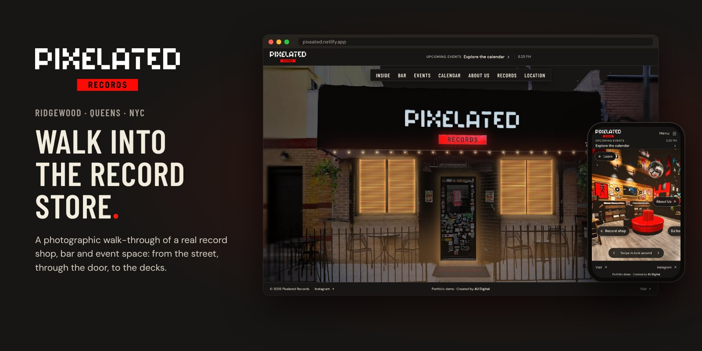
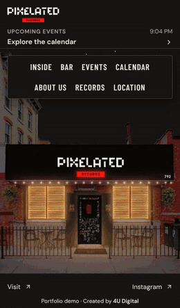
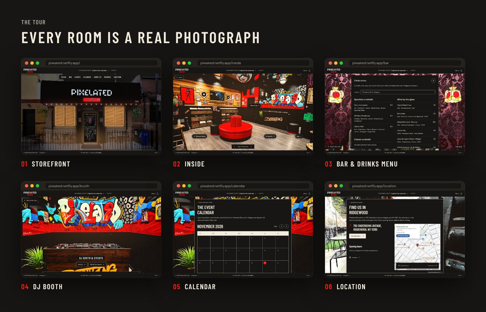
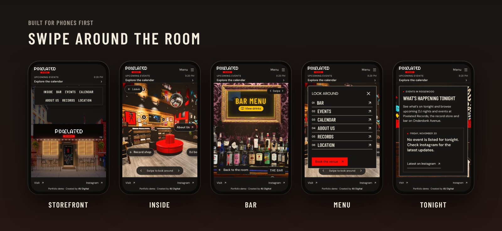

<p align="center">
  
</p>

<p align="center">
  <a href="https://pixeated.netlify.app/"><b>▶ Visit the live demo</b></a>
  &nbsp;·&nbsp;
  <a href="docs/media/demo-desktop.mp4">Desktop video</a>
  &nbsp;·&nbsp;
  <a href="docs/media/demo-phone.mp4">Phone video</a>
</p>

<p align="center">
  
  
  
  
</p>

# Pixelated Records

The website for **Pixelated Records**: a record shop, bar and event space at 792 Onderdonk Avenue in Ridgewood, Queens. Instead of a page of boxes, visitors walk in. They start on the street in front of the real shop, step through the door, look around the room, and tap into the bar, the DJ booth or the record bins.

Every scene is a photograph of the venue itself, with its real signage, artwork, furniture and layout. Records are on the left, the DJ booth is straight ahead and the bar is on the right, just as they are in person.

> This copy is a **portfolio demo**. It is public but kept out of search results, and its footer says so. The original site lives separately at [pixelatedrecordsnyc.netlify.app](https://pixelatedrecordsnyc.netlify.app/).

## See it in action

<table>
  <tr>
    <td width="68%" valign="top">
      <a href="docs/media/demo-desktop.mp4"></a>
      <p align="center"><b>Desktop</b> · storefront → inside → bar → DJ booth → location</p>
    </td>
    <td width="32%" valign="top">
      <a href="docs/media/demo-phone.mp4"></a>
      <p align="center"><b>Phone</b> · swipe around the room</p>
    </td>
  </tr>
</table>

Click either preview for the full-quality MP4.

## The tour

<p align="center">
  
</p>

| Stop                      | What happens there                                                                                                                                                                                            |
| ------------------------- | ------------------------------------------------------------------------------------------------------------------------------------------------------------------------------------------------------------- |
| **Storefront**            | The real front of the shop. The sky follows New York's actual sunrise and sunset, so the windows glow at night. The main links sit on one slim bar in the sky.                                                |
| **Inside**                | Records on the **left**, DJ booth **ahead**, bar on the **right**, and About Us on the back door. Drag (desktop) or swipe (phone) to look around.                                                             |
| **Bar**                   | The gilded frame on the wall _is_ the button: tap **Bar Menu** for cocktails, wine, beer, zero-proof drinks and coffee, with prices.                                                                          |
| **DJ booth**              | Tonight's show first, then upcoming events as a poster carousel, plus **Book the venue**.                                                                                                                     |
| **Events & Calendar**     | One shared event list powers the header, the booth, Tonight, Upcoming and a month calendar. Late shows stay "live" past midnight, and **Happening live now** appears only while an event is actually running. |
| **Record shop & Records** | Shop vinyl in person; the online shop is marked as coming soon.                                                                                                                                               |
| **About & Location**      | The story, the address, a map, directions that open with the venue filled in, and opening hours.                                                                                                              |

## Made for phones

<p align="center">
  
</p>

- Every cropped photo can be swiped side to side; a small hint shows where it helps and stays out of the way on text pages.
- Large tap targets (44px or more), one-handed menu, readable text sizes and no sideways page scrolling.
- Keyboard support, visible focus, a skip link, Escape-to-close dialogs and reduced-motion support.

## Owner’s Studio

Open `/admin` to sign in. The password is verified on the server; no actual password is committed to this repository.

The Studio includes friendly forms for pages and sections, navigation, event scheduling in venue time, menu categories and items, contact information, hours, logos, colors, photographs, window masks, and room hotspots. Photographic overlays can be dragged/resized, and phone focal points can be adjusted independently.

**Save draft** preserves edits privately. **Preview** opens an authenticated draft preview. **Publish** makes the saved version public. The Studio also includes undo, recent version restoration, media replacement, and conflict detection when another tab has saved a newer version.

There are no sample event dates, invented menu prices, or fabricated business hours in the published seed content. Add confirmed information in the Studio before launch.

## Local development

Use Node.js 22, as specified in `.nvmrc`.

```bash
npm ci
cp .env.example .env.local
npm run hash-password
```

Place the generated hash in `ADMIN_PASSWORD_HASH` in `.env.local`. Generate a random session secret and put it in `SESSION_SECRET`:

```bash
node -e "console.log(require('node:crypto').randomBytes(48).toString('hex'))"
```

Then start the site:

```bash
npm run dev
```

The site runs at `http://localhost:3000`. Local drafts, publications, media, sessions, and login throttles are stored in the ignored `.data` directory and survive process restarts. This local store is for development and review. Netlify production uses durable storage instead of the deployed filesystem.

## Checks

```bash
npm run typecheck
npm test
npm run build
```

The tests cover draft/public separation, authentication and origin checks, persistence, concurrent saves, restoration, private media, unsafe content rejection, login throttling, logout revocation, overnight/DST event rules, calendar dates, public-link visibility, draft-preview URLs, and editable public controls.

A production build can be reviewed on your own machine with `CONTENT_STORAGE=local`, without deployment-platform environment variables:

```bash
npm run build
npm start
```

## Production: Netlify Free

The owner has approved **Netlify Free** for this website. The production design uses Netlify’s Next.js runtime and Netlify Blobs for content, private uploads, sessions, and sign-in throttles. A separate Supabase project is not required for this setup; its adapter remains an optional alternative.

`netlify.toml` builds from the repository root with `npm run build` and publishes `.next`. `.nvmrc` selects Node 22. Netlify supplies its current OpenNext adapter automatically; do not change the application to a static export or add an SPA catch-all redirect. See Netlify’s [Next.js support](https://docs.netlify.com/build/frameworks/framework-setup-guides/nextjs/overview/) and [build settings](https://docs.netlify.com/snippets/frameworks/nextjs-config-values/).

Configure `CONTENT_STORAGE=netlify` and private runtime environment variables for the password hash, session secret, and matching canonical HTTPS origins for `APP_ORIGIN` and `SITE_URL`. Production and deployment-preview data use separate stores. Withhold production authentication secrets from ordinary previews; explicitly configured preview editing uses its own isolated store. Follow [the publishing setup](docs/PUBLISHING.md) for the exact values and isolation rules.

Netlify’s current Free plan has a hard monthly credit allowance. Exhausting it pauses the team’s projects until the allowance refreshes; Free has no automatic recharge. Keep the project on Free, without paid add-ons or upgrades. This is a usage-limited service, not a promise of unlimited availability. See [Netlify’s Free plan limits](https://docs.netlify.com/manage/accounts-and-billing/billing/billing-for-credit-based-plans/credit-based-pricing-plans/) and [pause behavior](https://docs.netlify.com/manage/accounts-and-billing/billing/resume-paused-projects/).

Configuration in this repository is not evidence of a live deployment. Account connection, live storage, production sign-in, and browser behavior must be verified separately. See [the current verification status](docs/BUILD_STATUS.md) for actual results.

## Main files

- `src/components/PublicExperience.tsx` — public pages and interactive room.
- `src/components/admin/` — the owner’s Studio.
- `src/lib/seed.ts` — initial verified venue details and editable starter copy.
- `src/lib/events.ts` — shared event/date rules.
- `src/lib/server/` — content storage, authentication, validation, and uploads.
- `src/app/api/` — authenticated administration and published-content endpoints.
- `public/assets/` — optimized derivatives of the provided photographs and logos.
- `netlify.toml` and `.nvmrc` — Netlify build configuration and Node version.
- `storage/pixelated.sql` — schema for the optional Supabase adapter.
- `tests/` — meaningful behavior and rendering regressions.

The supplied original photographs and logo archives are not duplicated in the repository. Web derivatives retain the original artwork, signage, furniture, and room orientation.
